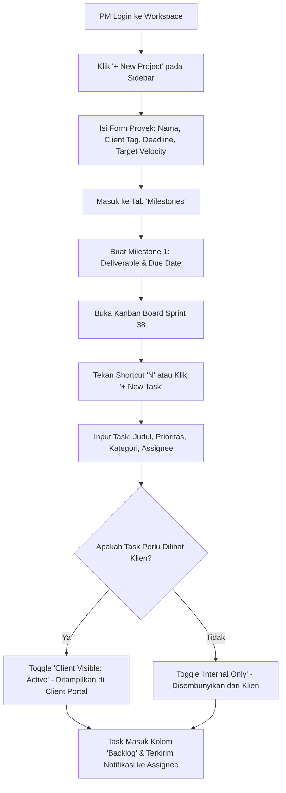
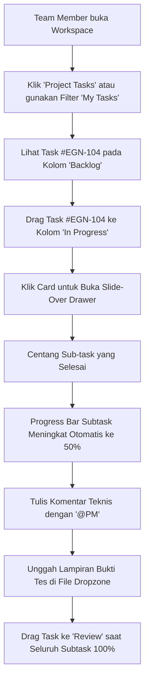
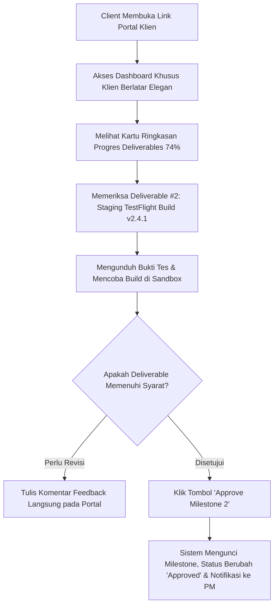

# Cetak Biru UX (User Experience Blueprint)
## Sistem Manajemen Proyek Modern (SaaS Internal & Portal Klien)

Dokumen ini disusun sebagai panduan arsitektur pengalaman pengguna (*User Experience Architecture*) untuk aplikasi manajemen proyek berdensitas tinggi (*high-density precision workspace*) yang memfasilitasi 3 persona utama: **Project Manager (PM)**, **Team Member (IC/Engineer/Designer)**, dan **Client (Stakeholder Eksternal)**.

---

## 1. Information Architecture (Sitemap)

Prinsip dasar Information Architecture ini adalah **"Rule of 3 Clicks"**: pengguna dari semua peran dapat mencapai deliverable atau aksi kritis dalam maksimal 3 klik dari mana saja.

```
PULSE WORKSPACE
├── 1.0 Executive Dashboard [Global / L1]
│   ├── 1.1 KPI Telemetry (Active Projects, Tasks Due, Overdue, Velocity)
│   ├── 1.2 Portfolio Health Matrix (Progress Bar, Client Tag, Deadline)
│   └── 1.3 Recent Activity Stream & Critical Deadlines
│
├── 2.0 Project Workspace [Core Engine / L1]
│   ├── 2.1 Pinned Project Selector (Dropdown / Sidebar Dot)
│   ├── 2.2 View Switcher (Multi-View Stage)
│   │   ├── 2.2.1 Kanban Board (Backlog, In Progress, Review, Done)
│   │   │   └── [Action] Task Detail Slide-Over Drawer (Right Panel)
│   │   │       ├── Metadata Grid (Status, Priority, Assignee, Date)
│   │   │       ├── Description (Markdown WYSIWYG)
│   │   │       ├── Sub-task Checklist (Reactive Progress Ring)
│   │   │       ├── Attachments Dropzone
│   │   │       └── Comment Thread (@Mentions & Audit Trail)
│   │   ├── 2.2.2 List View (Spreadsheet Density, Multi-sort, Batch Actions)
│   │   └── 2.2.3 Timeline / Gantt View (Sprint Weeks, Dependencies, Milestone Gates)
│   └── 2.3 Filter & Quick Search Bar
│
├── 3.0 Milestone Governance [L1]
│   ├── 3.1 Contractual Milestones & Scope Gating
│   └── 3.2 Deliverable Verification & Signoff Audit Log
│
├── 4.0 Client External Portal [Segregated L1 / Guest Scope]
│   ├── 4.1 Project Overview & Delivery Schedule
│   ├── 4.2 Shared Deliverables Sandbox (Builds, Figma, Documentation)
│   ├── 4.3 Milestone Approval Action Center (1-Click Formal Approval)
│   └── 4.4 Direct Stakeholder Feedback Channel
│
└── 5.0 Workspace Settings & Administration [L1]
    ├── 5.1 Team & Role-Based Access Control (RBAC: PM, Member, Client)
    ├── 5.2 Integrations (GitHub, Stripe, Neon DB, Slack)
    └── 5.3 Theme & Notification Preferences
```

### Matriks Akses Peran (Role-Based Access Control Matrix)

| Fitur / Halaman | Project Manager (PM) | Team Member | Client (Klien) |
|---|:---:|:---:|:---:|
| **Executive Dashboard** | Akses Penuh (Finansial + Operasional) | Terbatas (Sprint Tasks & Deadlines) | *Restricted* (Hanya metrik proyeknya) |
| **Kanban / List / Timeline** | Buat/Ubah/Hapus Semua Task | Update Status Task Sendiri, Komentar | Read-Only (Hanya task bertanda *Client Visible*) |
| **Milestone Management** | Buat & Ajukan Milestone Review | Submit Deliverables | **Approve / Reject Milestone** |
| **Internal Comments & Billing**| Akses Penuh | Akses Penuh ke Task Teknis | *Hidden* (Hanya tab Discussion Publik) |

---

## 2. User Flow Utama (3 Skenario Kritis)

### Skenario 1: Project Manager (PM)
**Tujuan:** Membuat proyek baru, memecah milestone kontrak, dan menugaskan task sprint dengan batas visibilitas klien.



**Langkah Detail:**
1. **Inisiasi Proyek**: PM menekan tombol `+` pada *Pinned Projects* di Sidebar kiri. Memasukkan nama proyek (contoh: *Mobile App v2.4*), menautkan identitas klien (*Nike Tech*), serta menetapkan tanggal target *delivery*.
2. **Penetapan Milestone**: PM menuju tab *Milestones*, mendefinisikan *Milestone 2: Biometric Auth & Core Checkout Engine* lengkap dengan *Acceptance Criteria*.
3. **Pemberian Tugas (Task Assignment)**: Pada Kanban Board, PM menekan tombol keyboard `N` untuk memunculkan modal pembuatan task cepat. PM mengisi judul (*Implement biometric FaceID authentication flow*), menetapkan prioritas *Urgent (P0)*, memilih *Assignee* (Sarah Connor), dan menandai *Client Visible*.
4. **Verifikasi**: Task langsung muncul di kolom *Backlog* Sarah dan otomatis masuk ke daftar deliverable di *Client Portal* dalam status *Queued*.

---

### Skenario 2: Team Member (Engineer / Designer)
**Tujuan:** Memperbarui progres task, menyelesaikan sub-tasks checklist, dan berdiskusi di kolom komentar dengan `@mention`.



**Langkah Detail:**
1. **Fokus Kerja**: Member melihat daftar task yang ditugaskan kepadanya. Menarik (*drag*) kartu `#EGN-104` dari kolom *Backlog* ke *In Progress*. Kartu seketika memperbarui status secara *optimistic* tanpa *page reload*.
2. **Inspeksi & Checklist**: Mengklik kartu untuk membuka *Task Detail Slide-Over Drawer* dari sisi kanan layar. Member mencentang checklist sub-task: *"Audit LocalAuthentication entitlement plist keys"*. Progress bar sub-task langsung melompat dari `0%` ke `25%`.
3. **Kolaborasi Kontekstual**: Pada area komentar di bawah drawer, member mengetik: *"@Marcus pastikan salt enkripsi sudah terpasang di KeychainItem wrapper"*. Menekan `Enter` untuk mengirim, memicu notifikasi instan ke Marcus.
4. **Handoff ke QA/Review**: Setelah semua sub-task selesai dan file *test log* di-drop ke area lampiran, member memindahkan status task ke *Review / QA*.

---

### Skenario 3: Client (Stakeholder Eksternal)
**Tujuan:** Memantau kemajuan proyek, mengunduh deliverable hasil kerja, dan memberikan tanda tangan approval formal pada milestone.



**Langkah Detail:**
1. **Akses Aman & Terisolasi**: Klien masuk melalui portal aman (*guest token* atau akun SSO). Tampilan hanya menyajikan metrik proyek klien tanpa menampilkan estimasi internal tim atau task internal backend.
2. **Inspeksi Hasil**: Klien melihat kartu *Milestone 2: Biometric Auth & Core Checkout Engine* dalam status *Under Review*. Klien meninjau catatan rilis dan menguji build sandbox TestFlight.
3. **Persetujuan Resmi (Signoff)**: Klien mengklik tombol *"Approve Milestone 2"*. Sistem menampilkan modal konfirmasi singkat. Setelah diklik, status seketika berubah menjadi *"Approved"*, mencatat nama penandatangan beserta stempel waktu ISO, serta mengirimkan notifikasi perayaan ke seluruh tim proyek.

---

## 3. Wireframe Layout (ASCII & Grid Blueprint)

### A. Executive Dashboard Layout (Desktop High-Density Grid)

```
+-------------------------------------------------------------------------------------------------------------------+
|  [P] Pulse HQ [PRO]  |  Pulse Workspace > Projects > Mobile App v2.4   [Q Search ⌘K]   [+ New Task]  (🔔)  [Avatar] |
+----------------------+--------------------------------------------------------------------------------------------+
| [Core Workspace]     |  Executive Dashboard                                        Sprint: Nov 15 - 28  [Export]  |
| - Dashboard (Active) |  +--------------------+--------------------+--------------------+------------------------+ |
| - Project Tasks (18) |  | ACTIVE PROJECTS    | DUE THIS WEEK      | OVERDUE TASKS      | OVERALL VELOCITY       | |
| - Milestones (3)     |  | 12  (+2 this mo)   | 28  (4 teams)      | 3  (Immediate)     | 88.4%  (+4.2%)         | |
| - Client Portal      |  | 8 Client • 4 Int   | 9 due in 48h       | -1 vs yesterday    | [========---] 88.4%    | |
|                      |  +--------------------+--------------------+--------------------+------------------------+ |
| [Pinned Projects]    |                                                                                            |
| * Mobile App v2 (74%)|  ACTIVE PORTFOLIO PROGRESS (2 Columns)                  RECENT ACTIVITY FEED (1 Column)    |
| * Stripe Billing(42%)|  +----------------------------------------------------+ +--------------------------------+ |
| * Brand Design (89%) |  | Mobile App v2.4 [Client: Nike]           74%       | | [Avatar] Sarah moved FaceID    | |
| * SOC2 Audit (Overdue|  | [======================--------] 18/24 completed   | | to Done               14m ago  | |
|                      |  |                                                    | | [Avatar] Marcus uploaded Figma | |
| [Footer]             |  | Stripe Subscriptions [Internal]          42%       | | exports               42m ago  | |
| [Theme: Dark / Light]|  | [============------------------] 8/19 completed    | | [Avatar] Nike Lead commented on| |
| API Online • v1.4.0  |  |                                                    | | Milestone 2           2h ago   | |
+----------------------+--+----------------------------------------------------+--+--------------------------------+--+
```

### B. Kanban Board & Task Detail Slide-Over Drawer Layout

```
+--------------------------------------------------------------------------------------+----------------------------+
|  Pulse Workspace > Projects > Mobile App v2.4               [Q Search ⌘K]  [+ Task]  | TASK DETAIL DRAWER (#EGN104)
+--------------------------------------------------------------------------------------+----------------------------+
| [Tabs: [Kanban Board] | [List View] | [Timeline] ]   Filters: [All] [Design] [Backend]| Status: [In Progress v]    |
+------------------+------------------+------------------+-----------------------------+ Priority: [Urgent (P0) v]  |
| BACKLOG (2)  [+] | IN PROGRESS (3)[+]| REVIEW / QA (1)[+]| DONE (2)                [+] | Assignee: [Sarah Connor v] |
+------------------+------------------+------------------+-----------------------------+ Due Date: [2026-11-22    ] |
| [#EGN-104]       | [#EGN-92]        | [#EGN-84]        | [#EGN-77] (line-through)    +----------------------------+
| Biometric FaceID | Webhook Lock     | Multi-tenant     | Neon Postgres Migration     | DESCRIPTION                |
| [Security][Client| [Backend]        | RBAC QA          | [DevOps]                    | Support local hardware     |
| [v] 1/4  (💬3)   | [v] 2/3  (💬5)   | [v] 4/4  (💬6)   | Completed (Nov 18)          | enclave integration...     |
| Nov 22  [Avatar] | Nov 23  [Avatar] | Nov 24  [Avatar] | [Avatar]                    +----------------------------+
| (Drag Hover --->)|                  |                  |                             | SUB-TASKS (1 of 4, 25%)    |
|                  | [#EGN-99]        |                  | [#EGN-72]                   | [=================-------] |
| [#EGN-108]       | 1-Click Pay      |                  | Brand SVG Icons             | [X] Audit LocalAuth plist  |
| Offline Banner   | [Frontend]       |                  | [Design]                    | [ ] Handle BiometricPrompt |
| [Design]         | [v] 3/4  (💬2)   |                  | [Avatar]                    | [ ] Connect Keychain Token |
| Nov 29  [Avatar] | Nov 25  [Avatar] |                  |                             | [+ Add a subtask...      ] |
|                  |                  |                  |                             +----------------------------+
|                  | [#EGN-110]       |                  |                             | ATTACHMENTS (2)            |
|                  | Dark Mode Token  |                  |                             | [Cloud Upload Dropzone   ] |
|                  | [Design]         |                  |                             | - FaceID_UserFlow.pdf (2MB)|
|                  | Nov 30  [Avatar] |                  |                             +----------------------------+
|                  |                  |                  |                             | DISCUSSION & @MENTIONS     |
|                  |                  |                  |                             | [Marcus]: @Sarah check salt|
|                  |                  |                  |                             | [Write a comment...  [Send]]
+------------------+------------------+------------------+-----------------------------+----------------------------+
```

---

## 4. Rekomendasi Micro-interactions

Untuk menghadirkan sensasi kerja berkecepatan tinggi setara Linear dan Notion, berikut adalah 7 mikro-interaksi kritis:

1. **Global Keyboard Command Palette (`Cmd+K` / `Ctrl+K`)**:
   - Menekan `Cmd+K` memunculkan modal pencarian instan tanpa mengangkat tangan dari keyboard.
   - Shortcut `N` langsung membuka modal pembuatan task baru; shortcut `T` beralih antara tema gelap (*Dark Mode*) dan terang (*Light Mode*); tombol `Esc` menutup modal/drawer apa pun.

2. **Drag-and-Drop Feedback Dinamis**:
   - Saat kartu ditarik (*drag*), kartu sedikit membesar (`scale-105`), sudut kemiringan bergeser 1.5 derajat, dan menghasilkan bayangan lembut (*soft ambient shadow*).
   - Kolom target yang menjadi area jatuhnya kartu (*hover dropzone*) menampilkan garis tepi aksen indigo (`border-brand-500`) dan latar berarsir halus, memberi kepastian visual ke mana task akan ditempatkan.

3. **Checklist Progress Ring Reaction**:
   - Setiap kali sebuah subtask dicentang, teks seketika tercoret (*strikethrough*) dengan animasi pudar lembut (*opacity fade*), dan progress bar di atasnya meluncur mulus (*cubic-bezier transition*).
   - Saat checklist mencapai 100%, badge berubah dari netral menjadi hijau emerald dengan ikon checklist menyala.

4. **Optimistic UI Updates dengan Rollback Protection**:
   - Perubahan status task di Kanban atau List View langsung diaplikasikan di antarmuka sebelum request jaringan ke server selesai.
   - Jika koneksi gagal, sistem mengembalikan kartu ke posisi semula disertai pesan *toast* peringatan merah dan opsi *retry*.

5. **Contextual Status Pills & Inline Editing**:
   - Judul task pada drawer dapat langsung diedit dengan sekali klik (*click-to-edit inline*) tanpa tombol simpan terpisah. Sistem melakukan *auto-save on blur*.

6. **Toast Notification Stack**:
   - Banner notifikasi meluncur dari sudut kanan bawah dengan efek *spring animation* saat aksi penting dilakukan (misal: *"Task #EGN-104 moved to Review"*, *"Milestone 2 Approved ✓"*), dan menghilang otomatis setelah 3 detik.

7. **Client Visibility Transparency Dot**:
   - Task yang dapat dilihat oleh klien eksternal memiliki penanda visual khusus (*Client Visible Badge* berwarna indigo lembut). Hal ini mencegah tim internal secara tidak sengaja membagikan catatan sensitif tanpa mengurangi fleksibilitas kolaborasi.
